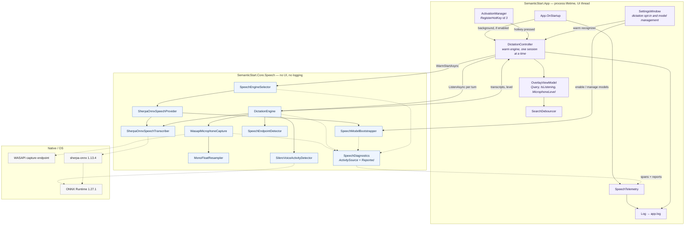
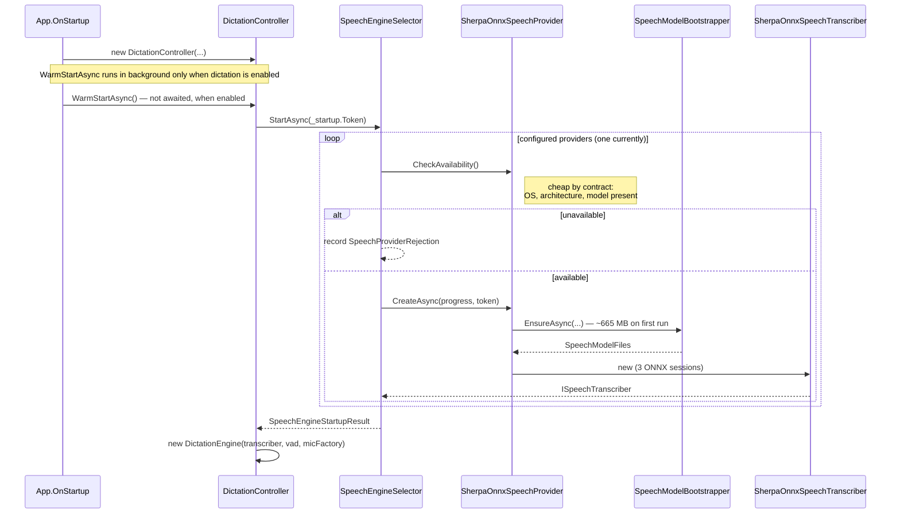
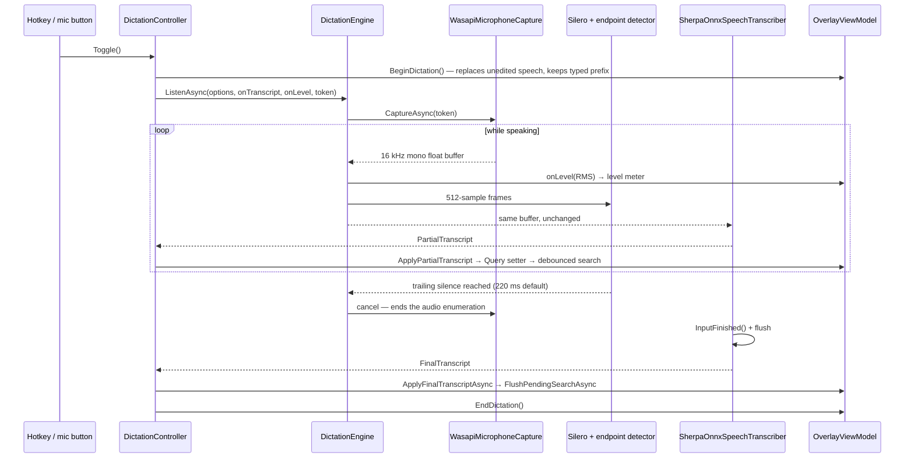
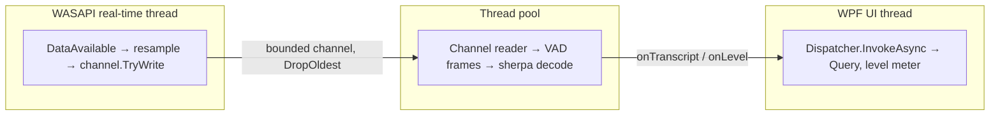
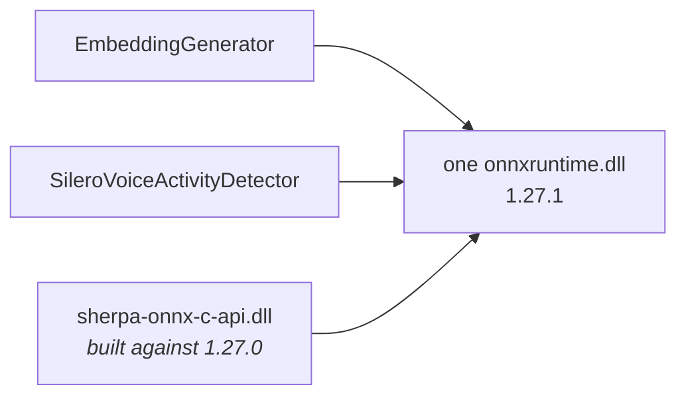

# Dictation architecture

A reference for the optional offline dictation feature. For the indexing and search pipeline, see
[How it works](../README.md#how-it-works).

Dictation sends partial and final transcripts to `OverlayViewModel.Query`, which uses the existing
search path. The controller also coordinates listening state, microphone feedback, and errors; the
search, ranking, and launch path does not need to know that a query came from speech.

Silero v5.1 consumes 512 new samples (32 ms at 16 kHz) preceded by the previous frame's
64-sample context. Context starts at zero and is reset along with recurrent state on each turn;
the ONNX input is `[1, 576]`, not `[1, 512]`. The streaming Parakeet recognizer decodes with
greedy search - its native implementation does not support beam search at all, unlike the
streaming Zipformer this app used before - so there is no `MaxActivePaths` to tune in
`speech-model.json` any more.

## The shape of it

Solid arrows show calls or data flow; dotted arrows mark native boundaries or one-way diagnostics.

## Two timelines, and why they are separate

When dictation is enabled, the recognizer is warmed before the first listening turn: at app startup
if already enabled, or when enabled from Settings. Model preparation is initiated there rather than
by the hotkey; a press made while preparation is still underway waits for it to finish.

### Startup (once per process)

If this fails, the reason is *remembered*, not thrown — the rest of the app works fine without
dictation, and the reason is exactly what the user needs when they press the hotkey and nothing
happens. Every rejection is logged with its exception intact, not just the first one that reaches
the status line.

### One listening turn per hotkey press

Two details in that diagram are load-bearing:

- **Audio is forwarded before it is examined.** `DictationEngine.EndpointedAudioAsync` yields each
  buffer to the transcriber and *then* feeds it to the VAD, so endpointing never sits between the
  microphone and the decoder.
- **Ending the audio is what produces the final.** The endpoint cancels the microphone rather than
  merely stopping the read, because the transcriber flushes on enumeration end. Without that, the
  last syllable of every utterance stays in the encoder's lookahead window.

## The pieces

| Type | Responsibility | Why it exists separately |
|---|---|---|
| `ISpeechTranscriber` | Audio in, transcripts out | Carries the local-only rationale, including why `Windows.Media.SpeechRecognition`, SAPI and Win+H are excluded |
| `ISpeechTranscriberProvider` | Availability + construction | Availability is answered without loading anything, so startup can ask every provider |
| `SpeechEngineSelector` | Picks a provider, keeps the rejections | The seam a second engine plugs into without touching settings or the overlay |
| `SpeechProviderMetadata` | Capability flags | Partial support and download size are read by the UI, so a batch-only engine needs no new branches |
| `PartialTranscript` / `FinalTranscript` | Two kinds of claim | Separate types, so a consumer that forgets the distinction fails to compile rather than launching on half a word |
| `IAudioCaptureSource` | The microphone, abstracted | Every audio consumer is testable from recorded samples; build servers have no microphone |
| `WasapiMicrophoneCapture` | Event-driven low-latency capture | Bounded channel with `DropOldest`: stalling WASAPI's real-time thread glitches capture for the whole machine |
| `MonoFloatResampler` | Device format → 16 kHz mono float | Stateful across buffers, so the seam between WASAPI packets does not dip |
| `SileroVoiceActivityDetector` | Per-frame speech probability | Recurrent state, so it belongs to one session and is reset between turns |
| `SpeechEndpointDetector` | Turns probabilities into "they have stopped" | Pure and testable; the tuning the user can see in Settings lives here |
| `SherpaOnnxSpeechTranscriber` | Streaming Parakeet decode | Its own endpointing is disabled — two endpoint rules would race |
| `DictationEngine` | Wires the above into one turn | Long-lived and warm; `ListenAsync` loads nothing |
| `SpeechModelBootstrapper` | Fetches models and required legal files on first use | Mirrors `EmbeddingModelBootstrapper`: same temp file, progress and size floors; readiness includes the agreement and attribution |
| `SpeechModelOptions` | Where the models come from | Holds every URL, checksum and size floor, so a mirror or a newer revision is a `speech-model.json` away rather than a rebuild |
| `SpeechDiagnostics` | Spans + everything handled internally | Keeps Core log-free while making swallowed failures visible |
| `DictationController` | Hotkey → overlay, session lifetime | The only place that knows about both `Dispatcher` and `DictationEngine` |
| `SpeechTelemetry` | The one `ActivityListener` | Turns Core's spans into `TRACE` lines in the app's existing log |

## Model licensing and cached upgrades

Application code is MIT, sherpa-onnx runtime/export code is Apache-2.0, and Parakeet Unified
weights are under the separate NVIDIA Open Model License. Silero VAD is MIT.
`SpeechModelBootstrapper` downloads a complete plain-text agreement from a pinned NVIDIA/NVlabs
source, verifies its SHA-256, and atomically saves `<ModelId>-LICENSE.txt` alongside the weights
in `%LOCALAPPDATA%\SemanticStart\models`. It also writes `<ModelId>-Notice.txt` with the exact
attribution `Licensed by NVIDIA Corporation under the NVIDIA Open Model License`.
Both files are required by readiness and must accompany redistributed weights (agreement
section 3.1); linking the web agreement alone is not a substitute.

Legal files are prepared before downloading weights. Setup backfills missing legal files for
existing caches without downloading the weights again, and reports failures rather than loading
a model with missing legal files. Cancellation removes incomplete temp files.
`speech-model.json` supports `LicenseUrl`, `LicenseSha256`, `MinimumLicenseBytes`, and
`LicenseNotice` overrides for mirrors or differently licensed models. Overrides must provide a
complete plain-text agreement, not HTML, and the appropriate attribution and checksum.

## Threading

Decoding is synchronous CPU-bound work on whichever thread enumerates the transcript stream, and
that thread must never be the UI thread — `DictationController.RunSessionAsync` is what guarantees
it, by marshalling only the results back through the dispatcher.

## Failure paths

None of these are silent. The rule for this feature is that a dictation session producing no words
always has a reason attached.

| Failure | Where it surfaces | What the user sees |
|---|---|---|
| No microphone / access denied | `MicrophoneUnavailableException` with a `MicrophoneFailure` | The overlay names **"Let desktop apps access your microphone"** |
| Capture thread fault | NAudio's `RecordingStopped` → channel completion | Rethrown to the consumer, and reported to the log |
| Audio buffers dropped | Channel `itemDropped` counter | Trace line and a span tag — the audio thread has nobody to throw to |
| Microphone fails to stop | Reported, not rethrown | Log only; the session is ending either way |
| Provider fails to load | `SpeechProviderRejection` keeps the exception | Status line, with the stack in the log |
| Model download fails | `SpeechModelDownloadException` | Settings status text, partial file deleted |
| Shutdown mid-load | `_startup` token | Logged as shutdown, not as a failure |

## The ONNX Runtime constraint

`Microsoft.ML.OnnxRuntime` (the index's embedding model, and Silero) and `org.k2fsa.sherpa.onnx`
(the transcriber) both ship `runtimes/<rid>/native/onnxruntime.dll`, and a publish picks one
silently. ORT serves consumers built against the same or an *older* API, never a newer one, so the
surviving copy must be at least as new as sherpa's build target.

**The two package versions must be bumped together.** `ResolveDuplicateOnnxRuntimeNative` in
`SemanticStart.Core.csproj` makes the surviving copy a decision rather than item ordering, but it
does not make a mismatched pair safe.
